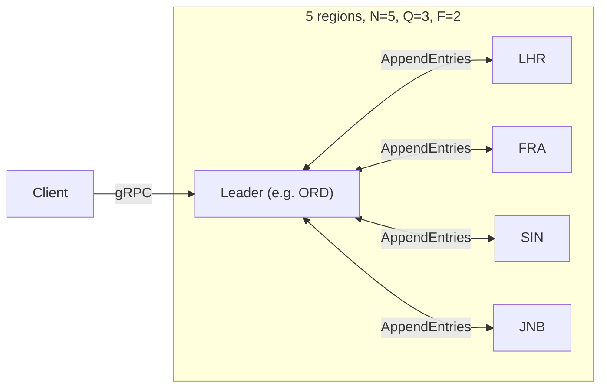
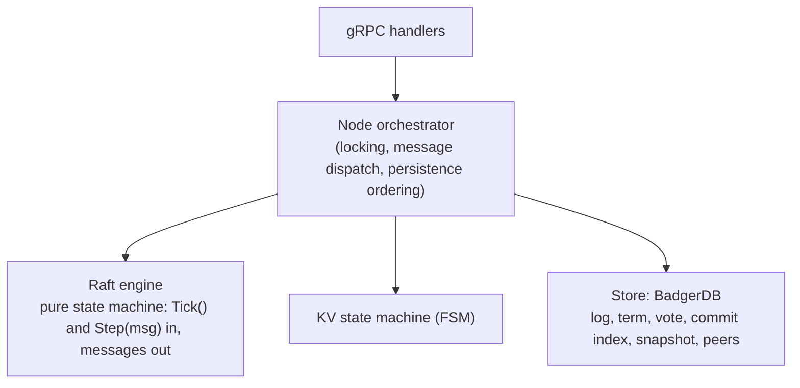
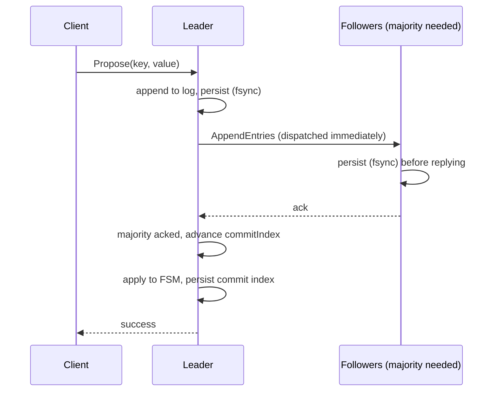
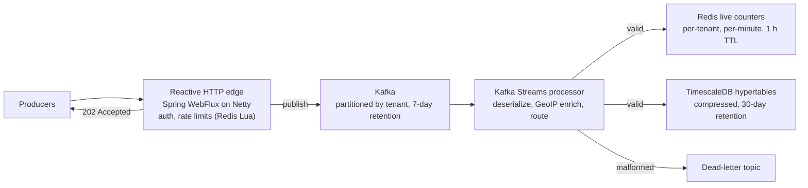
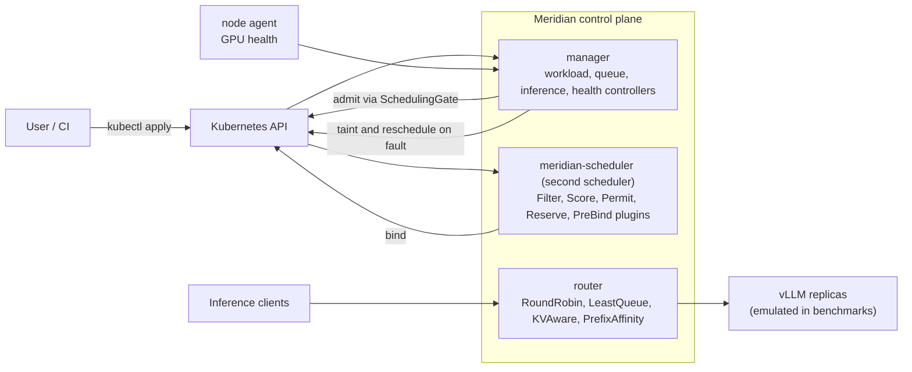

# Distributed Systems & Infrastructure: Design, Verification, and Limits

**Basit Tijani** · Backend infrastructure engineer · First published May 2026 · Revised November 2026 (Rev. 2.0)

Three systems I designed and built, documented the way I would want a colleague to document them for me: what each system guarantees, how it fails, what was actually measured, and what is still unproven.

| System | What it is | Stack | Evidence level |
| :--- | :--- | :--- | :--- |
| [**Phalanx**](https://github.com/tijani-web/phalanx) | Raft-replicated, strongly consistent key-value store across 5 regions | Go, BadgerDB, gRPC, memberlist (SWIM) | Independently audited, bugs fixed with tests, local benchmarks. WAN and real-crash testing not done |
| [**ARGUS**](https://github.com/tijani-web/argus) | High-throughput, non-blocking event ingestion platform | Java 21, Spring WebFlux, Kafka Streams, TimescaleDB, Redis | Design documented; performance figures are author-reported and not independently reproduced |
| [**Meridian**](https://github.com/tijani-web/meridian) | Kubernetes-native GPU fleet control plane (gang scheduling, preemption, inference router) | Go, Kubernetes scheduler framework, controller-runtime | Benchmarks on simulated nodes and an emulated inference server; real-vs-simulated table published |

A fourth project, Sentinel-AI (Java 21, Spring AI), is not covered here.

## How to read this document

Every claim carries one of three labels. If a claim has no label, it is a design statement, not a result.

| Label | Meaning |
| :--- | :--- |
| ✅ **Verified** | Backed by a test or benchmark committed to the repository, tied to a commit or result file |
| 📋 **Author-reported** | A figure or behavior I observed, but the raw data or method is not published here |
| ⛔ **Not measured** | Explicitly untested. Where useful, I give an analytical expectation and label it as analysis |

## Contents

1. [Engineering principles](#engineering-principles)
2. [Phalanx](#1-phalanx--distributed-consensus-kv-store)
3. [ARGUS](#2-argus--high-throughput-event-ingestion)
4. [Meridian](#3-meridian--gpu-fleet-control-plane)
5. [What auditing my own systems taught me](#what-auditing-my-own-systems-taught-me)
6. [Open items](#open-items)
7. [Evidence index](#evidence-index)
8. [References](#references)

---

## Engineering principles

**Failure modes first.** Before writing code: what breaks, how does it break, and how long does recovery take? The Raft pure state machine, the atomic Redis rate limiter, the Kafka dead-letter branch, and Meridian's atomic gang admission are consequences of failure-mode analysis, not later optimizations.

**Pure core, impure shell.** Consensus logic and scheduling decisions are kept free of I/O, clocks, and networking where possible, so they can be tested deterministically.

**Explicit tradeoffs.** Every decision records what it gains and what it costs. Phalanx and Meridian keep decision records in `docs/`.

**Measure, then claim.** The most valuable thing I did on Phalanx was run an independent audit against my own documentation. It found that several claims I had written were not true of the code. Those are listed below, along with the fixes. A system documented honestly is more useful than one documented optimistically.

**Operate what you build.** I carry on-call for Phalanx and ARGUS, which shapes decisions toward graceful degradation and debuggability at 3 AM.

---

## 1. Phalanx — distributed consensus KV store

### 1.1 Problem and guarantees

A key-value store spanning geographic regions must stay consistent through network partitions. Leader/follower replication cannot guarantee that; consensus can. Phalanx uses Raft across 5 nodes (N=5, quorum Q=3, tolerated failures F=2).

| Property | Mechanism | Status |
| :--- | :--- | :--- |
| Linearizable writes | Raft log, majority commit | ✅ Porcupine linearizability checker: 99 of 100 randomized nemesis seeds pass; 1 seed under analysis (see 1.9) |
| Linearizable reads | Current-term commit gate plus quorum-contact check | ✅ Stale-read tests pass. ⚠️ The quorum-contact check is tick-based, which is unproven under process pauses (see 1.14) |
| Durability | Log entries fsynced before acknowledgement; log and state replayed on restart | ✅ Crash-restart and full-cluster-restart tests pass. ⛔ `kill -9` and power-loss testing not done (the harness used graceful stops) |
| Available with 2 nodes down | Quorum 3 of 5 | ✅ Tested |
| Refuses service with 3 nodes down | Writes time out, reads return no-quorum error | ✅ Tested |
| No disruption from rejoining nodes | Pre-vote, leader stickiness | ✅ Unit tests |
| Stale leaders step down | CheckQuorum | ✅ Unit test |
| Safe membership changes | Single-server changes through the Raft log | ✅ Unit tests. ⚠️ See 1.14 |
| Bounded memory and disk | Snapshots and log compaction | ✅ Follower catch-up and restart-from-snapshot tests. ⛔ Long-run memory not measured |

### 1.2 Topology and layers

Five nodes, one per region. Peer discovery uses HashiCorp memberlist (SWIM gossip) for finding candidates; membership itself is changed only through the Raft log (see 1.8). Transport is gRPC over HTTP/2 with a JSON codec.



Each node runs three layers:



### 1.3 Pure state machine design

The Raft engine imports no network or storage packages, performs no I/O, and spawns no goroutines. It receives `Tick()` and `Step(msg)` and appends outgoing messages to an internal buffer. The Node layer reads that buffer, persists what must be durable, and dispatches messages.

| What this gains | What it costs |
| :--- | :--- |
| Thousands of consensus rounds run deterministically in-process with no clock | The Node layer owns the complexity of dispatch and persistence ordering |
| No coupling to network, storage, or timing; portable to simulators and mocks | Live-network debugging of Raft internals is harder |
| Persistence ordering rules (below) are enforced in one place | A realistic test harness is required |

### 1.4 Concurrency model

Multi-threaded I/O, single-threaded consensus. gRPC handlers run as goroutines and take the node mutex only while touching Raft state. A background loop runs `Tick()`, `applyCommitted()`, persistence, and message dispatch serialized under the same lock. Client concurrency scales without sharing consensus state across threads.

### 1.5 Write path



Persistence ordering is the core safety rule: a follower persists before it acknowledges an append, a leader persists its own entries before dispatching them, and a node persists term and vote before granting or sending vote requests.

Commit latency is bounded below by one round trip to the second-nearest peer (the leader plus two followers form a quorum of 3). Proposals trigger replication immediately; they do not wait for the next heartbeat tick.

### 1.6 Read path

Reads are served only when the leader (a) has committed an entry from its current term, which is Raft's requirement before a new leader can trust its commit index, and (b) has confirmed quorum contact. The fast path avoids a log entry per read. The quorum-contact check is tick-counted; see 1.14 for why that matters and what is open.

### 1.7 Storage layout

BadgerDB holds everything under prefixed keys: log entries (`l:<8-byte index>`), term, vote, commit index, peer configuration, and snapshot. `SyncWrites` is on, so every committed transaction is fsynced. I used BadgerDB's own transactions and crash recovery instead of a separate write-ahead-log file, to keep one storage layer (alternative: etcd-style WAL or raft-boltdb).

`ValueThreshold` is 64 bytes, which is **lower** than BadgerDB's 1 MB default (values above 64 bytes go to the value log). Other options are defaults, including bloom-filter false-positive rate (0.01). Snapshots are stored whole; after compaction, old log keys are deleted and value-log GC runs (`RunValueLogGC(0.5)`).

### 1.8 Elections, membership, and snapshots

- **Pre-vote and leader stickiness.** A node that times out first asks peers for pre-votes without incrementing its term. A partitioned node therefore cannot inflate its term and depose a healthy leader when it rejoins.
- **CheckQuorum.** A leader that has not heard from a quorum within an election timeout steps down, so an isolated minority leader stops accepting work.
- **Membership.** Gossip only discovers candidates. Adding or removing a server is a Raft log entry (single-server change, one pending change at a time); the configuration is applied on commit and persisted.
- **Snapshots.** The log is offset-aware, with a sentinel entry at the compaction point. A follower whose next index falls behind the compaction point receives an `InstallSnapshot`. Snapshots are sent as a single message, which is adequate for a KV state of this size and would need chunking for very large state.
- **Divergence detector.** The FSM keeps a rolling CRC64 over applied commands (about 15 ns per operation, 📋 micro-benchmark), and followers report it in append responses so the leader can compare it against its own (see 1.14 for a known limitation).

### 1.9 Verification: what an independent audit found

I ran an audit of the codebase against its own documentation, using a code review followed by a correctness suite (Porcupine linearizability checking under partitions, leader and follower crashes, and membership changes). The baseline commit was `1528e85`. The audit found real defects in claims I had made:

| # | Baseline finding (`1528e85`) | Resolution | Commit |
| :--- | :--- | :--- | :--- |
| 1 | **Critical.** Raft log entries were never written to disk (memory only, `SyncWrites=false`). A restarted node had an empty log | Persist and fsync entries before acknowledging; replay on restart | `895ae4e` |
| 2 | Reads could be served before the new leader committed an entry from its term; the "lease" was a heartbeat counter. Porcupine caught stale reads in 2 of 20 seeds | Current-term commit gate; bounded quorum-contact check | `9b986d8` |
| 3 | No CheckQuorum: an isolated leader stayed leader indefinitely | Step down without quorum contact | `96465c0` |
| 4 | Pre-vote was implemented on the receiving side but never initiated | Initiate pre-vote before any term increment | `af7d706` |
| 5 | Gossip join events edited the peer list directly, bypassing consensus | Removed the bypass; changes go through the Raft log | `cb2cc14` |
| 6 | No snapshots or log compaction (unbounded log) | `InstallSnapshot`, compaction, value-log GC | `974b584` |
| 7 | "FSM hash comparison each tick" in my docs did not exist in code | Replaced with a rolling CRC64 plus heartbeat comparison | `c1bc799` |
| 8 | Bootstrap used a fixed 2 s sleep and proceeded when any one peer resolved | Quorum-gated start, capped exponential backoff with jitter, background retry | `49e1a6f` |

Each fix was written test-first (a test that failed on the old code, then passed). Results after the fixes:

- ✅ Porcupine: **18 of 20** seeds passed at baseline; **99 of 100** pass after the fixes.
- ✅ Durability chaos test: 30 acknowledged writes survived a full-cluster stop and restart.
- ✅ 2 of 5 nodes down: writes commit and reads succeed. 3 of 5 down: writes time out and reads return a no-quorum error.
- ⚠️ **Seed 82 is unresolved.** A client timed out on a write during a simultaneous leader crash and asymmetric partition; the write had in fact committed. The likely cause is how the test harness records timed-out operations (a timed-out write must be modeled as "may have taken effect at any later time"), not a consensus bug, but I have not re-run it with that modeling. The failing trace is kept in the repository.

### 1.10 Performance (local, indicative only)

✅ Measured on a laptop (Intel i7-8665U, 4 cores, 16 GB RAM, NVMe SSD, Windows 11, Go 1.27.1), five nodes as separate processes on loopback, using the **fast test profile** (20 ms ticks). These are not production-profile or cross-region numbers. Runs were a few seconds per load level and single repetition, so tail percentiles rest on 100 to 1,500 samples. Treat them as a sanity check, not a benchmark.

Write latency, 128-byte payload, open-loop arrivals:

| Offered load (req/s) | Completed ops | p50 (ms) | p95 (ms) | p99 (ms) |
| ---: | ---: | ---: | ---: | ---: |
| 50 | 109 | 4.01 | 14.92 | 23.28 |
| 100 | 298 | 1.52 | 4.61 | 7.28 |
| 200 | 558 | 2.12 | 10.24 | 17.01 |
| 400 | 831 | 2.54 | 16.69 | 29.69 |
| 800 | 1,475 | 3.13 | 19.76 | 46.04 |

Payload size at 100 req/s: 64 B p50 2.20 ms / p99 17.33 ms; 1 KB p50 1.67 ms / p99 9.37 ms; 16 KB p50 12.36 ms / p99 69.74 ms.

Other measurements (fast profile):

| Measurement | Result |
| :--- | :--- |
| Leader failover (20 trials, leader killed, time to next acknowledged write) | median 376 ms, min 266 ms, p90 570 ms, max 597 ms |
| Follower rejoin after partition (5 trials) | median 47 ms |
| Cold bootstrap with injected DNS delay of 0 / 2,000 / 5,000 ms | 257 / 2,305 / 5,610 ms |
| Reads: quorum-checked path vs log-based reads | 1,079 vs 711 ops/s; p50 0.87 vs 1.04 ms (500 and 100 operations respectively) |

The baseline commit showed worse tail latency under the same harness (for example p99 of 715 ms at 800 req/s). I have not isolated why, so I make no causal claim.

**Storage engine.** Three BadgerDB configurations were compared for 5 seconds each on highly compressible synthetic 128-byte values: threshold 64 B async (21.6K ops/s), 1 MB default async (28.3K ops/s, about 4.5x smaller on disk), and 64 B with fsync (25.8K ops/s). The fsync run being faster than async shows these runs are within noise of each other. No compaction-heavy workload was run, so **I make no tuning claim** about `ValueThreshold`.

### 1.11 Cross-region expectations (analysis, not measurement)

⛔ No real multi-region or emulated-WAN measurement has been done. What follows is analysis from an **assumed** approximate round-trip matrix, useful for reasoning about leader placement:

A commit needs acknowledgements from the leader and two followers, so commit latency is at least the round trip to the **second-nearest** peer, plus fsync time on both sides.

| Leader region | Two nearest peers (assumed RTT) | Commit latency lower bound |
| :--- | :--- | :--- |
| London | Frankfurt 15 ms, Chicago 85 ms | about 85 ms |
| Frankfurt | London 15 ms, Chicago 95 ms | about 95 ms |
| Chicago | London 85 ms, Frankfurt 95 ms | about 95 ms |
| Singapore | London 160 ms, Frankfurt 165 ms | about 165 ms |
| Johannesburg | London 160 ms, Frankfurt 170 ms | about 170 ms |

Consequences: Europe-adjacent leaders are cheapest; consensus latency is dominated by geography, not CPU. The production profile uses 200 ms ticks with a 4 to 8 second randomized election timeout, so by configuration, failover after a leader loss is on the order of that window; it is a deliberate stability-over-speed choice for high-RTT links, and it is tunable.

### 1.12 Incident: cluster bootstrap failure

**Summary.** During the first 5-region deployment, nodes failed to form a quorum. The cluster sat in follower state with repeated election timeouts and no leader.

**Impact.** No cluster available at initial deployment (no user traffic at the time). 📋 Author-reported.

**Detection.** Repeated election timeouts and no leader, with no application-level error. The Raft state machine was behaving correctly.

**Root cause.** Not a code defect: an infrastructure-timing assumption. Peer discovery used gossip over IPv6 private networks, and nodes resolved peer hostnames immediately at startup. Across five continents, DNS propagation delay meant some nodes resolved a stale record or none, so peers could not reach each other and quorum never formed.

**Resolution.** Startup retried DNS resolution instead of resolving once. The version of that fix present at the baseline audit was a fixed 2-second retry (up to 30 attempts) that proceeded as soon as any one record resolved, and it attempted the seed join only once.

**Follow-up (audit, `49e1a6f`).** Replaced with quorum-gated startup (proceed once 3 of 5 peers resolve), capped exponential backoff with jitter, and a background task that keeps retrying lagging peers. ✅ Tested with injected DNS delay.

**Lesson.** Distributed systems often fail at infrastructure boundaries (DNS propagation, clock skew, network jitter) rather than in application logic. The architecture has to absorb real timing variation, and requiring *all* peers to resolve would itself contradict the fault-tolerance goal (N=5 must start with two peers down).

### 1.13 Design decisions

| Decision | Alternative considered | Why |
| :--- | :--- | :--- |
| Pure Raft engine with I/O in a node layer | Raft calling storage and network directly | Determinism and testability |
| BadgerDB for log and state, prefixed keys | Separate WAL file (etcd/wal, raft-boltdb) | One storage layer, existing transactions and recovery |
| Single-server membership changes | Joint consensus | Simpler state; adequate for N=5 |
| Whole-state snapshot messages | Chunked streaming | Adequate for KV-sized state; revisit for large state |
| Rolling checksum | Full-state hash per tick | O(N) cost per tick is prohibitive (reasoning; a full hash was not benchmarked) |
| Long election timeouts in production profile | Aggressive timeouts | Stability on high-RTT links |

### 1.14 Known limitations and open questions

| Area | Limitation |
| :--- | :--- |
| Crash testing | Restart tests used graceful shutdown. Real `kill -9` / power-loss testing is not done |
| Read path | The quorum-contact check is tick-counted. Ticks stop when a process is paused (GC, VM pause, SIGSTOP), so a resumed old leader could briefly believe it still holds contact. A wall-clock monotonic lease, or ReadIndex on every read, would close this. The design notes and the audit of the same commit describe this path differently; they should be reconciled |
| FSM checksum | Computed over the sequence of applied commands but recomputed from state after a snapshot restore, so values are not comparable across nodes that did and did not restore from snapshot. An order-independent state checksum would fix this |
| Membership | Besides one pending change at a time, a leader should commit an entry in its current term before accepting a configuration change. New servers join as voters, not learners |
| Leader transfer, joint consensus | Not implemented (leader transfer is Raft thesis section 3.10) |
| Race detector | `go test -race` needs a Linux or CGO environment. CI is configured but results were not captured on the benchmark host |
| Network | No real multi-region or emulated-WAN measurement |
| Seed 82 | Unresolved, probably a harness modeling issue (see 1.9) |

---

## 2. ARGUS — high-throughput event ingestion

### 2.1 Problem

Applications emit event streams at scale: page views, clicks, API latencies, health signals. A naive pipeline (parse, validate, write to a database) blocks on database latency under load, p99 latency spikes, and backpressure cascades upstream. ARGUS enforces a strict decoupling: **accept the event, publish it to Kafka, return `202 Accepted`. No database write happens on the hot path.**

### 2.2 Architecture



| Layer | Role |
| :--- | :--- |
| Edge (WebFlux/Netty) | Accept events, enforce rate limits, publish to Kafka, return 202 immediately |
| Kafka | Durable event log; per-tenant ordering through partition key; single source of ordering truth |
| Kafka Streams | Deserialize, enrich with MaxMind GeoIP, route; malformed payloads go to the dead-letter topic |
| Redis | Minute-granularity per-tenant counters feeding live dashboards; TTL bounds staleness |
| TimescaleDB | Compressed time-series storage, partitioned by time, with a 30-day retention policy and efficient range queries |

### 2.3 Reported performance

📋 **Author-reported; the load generator and raw results are not published here and have not been independently reproduced.**

| Metric | Reported value |
| :--- | :--- |
| Throughput | 8,000 to 15,000 events/s on a single 4-vCPU Azure VM |
| Ingestion latency | p50 8 ms, p99 120 ms |
| Rate limits | 50 req/s per IP, 5,000 req/s per API key (atomic Redis Lua) |
| Storage | about 500 GB for 30 days, compressed |
| Redis memory | about 2 GB for the 1-hour live-counter window |
| Effect of the reactive/blocking bridge (2.4) | about 3x throughput; p99 from 800 ms to 120 ms during development |

### 2.4 Three engineering challenges

**1. Bridging reactive and blocking code.** WebFlux runs on a small Netty event-loop pool. A blocking JPA call on an event-loop thread stalls every other request on that thread. The pattern is to wrap each blocking call and move it to a pool sized for blocking work:

```java
// Blocking repository call moved off the Netty event loop.
// Errors propagate; only "not found" becomes an empty Mono.
public Mono<Tenant> getTenant(String id) {
  return Mono.fromCallable(() -> tenantRepo.findById(id))   // Optional<Tenant>
      .subscribeOn(Schedulers.boundedElastic())
      .flatMap(Mono::justOrEmpty);
}
```

A common mistake is `onErrorResume(e -> Mono.empty())`, which makes a database outage indistinguishable from a missing record. Only genuine absence should map to empty.

**2. Atomic rate limiting under concurrency.** A naive GET, compute, SET sequence has a race window: many concurrent requests read the same count before any increment lands, and all pass. Moving the whole decision into one Redis Lua script removes the race, because Redis executes scripts atomically:

```lua
-- Fixed-window counter. KEYS[1]=bucket, ARGV[1]=limit, ARGV[2]=window in ms
local current = redis.call('INCR', KEYS[1])
if current == 1 then
  redis.call('PEXPIRE', KEYS[1], ARGV[2])   -- set TTL once, on first hit
end
if current > tonumber(ARGV[1]) then return 0 end  -- reject
return 1                                          -- allow
```

Two details matter. The TTL must be set only on the first increment; refreshing it on every request would stretch the window under steady traffic. And this is a fixed-window counter, which permits up to 2x the limit across a window boundary; a token bucket or sliding window is the alternative when that burst matters.

**3. Poison pills in Kafka Streams.** By default one malformed record can raise a deserialization exception that crashes the stream thread and, on restart, hits the same record again. ARGUS reads the topic as raw bytes, branches before typed deserialization, and routes failures to a dead-letter topic; the primary topology never sees malformed payloads. Dead-letter events can be replayed after the cause is fixed.

```java
KStream<String, byte[]> raw = builder.stream("raw-events");
raw.split()
   .branch((k, v) -> isValid(v), Branched.as("valid"))
   .branch((k, v) -> true,       Branched.as("invalid"));
// valid  -> deserialize -> "processed"
// invalid -> "raw-events-dlq"
```

A built-in alternative is Kafka Streams' deserialization exception handler; the explicit branch was chosen for visible routing and replay.

### 2.5 Invariants and failure-mode intent

| Invariant | Mechanism |
| :--- | :--- |
| Per-tenant ordering | Partition key is the tenant ID |
| Completeness (no accepted valid event dropped) | Kafka offsets, at-least-once delivery, idempotent upserts into TimescaleDB. This is effectively-once through idempotent sinks, not exactly-once delivery |
| Freshness | Redis TTL bounds staleness; counters are repopulated from TimescaleDB on a cache miss |

Design intent for common failures (not a record of tested failures):

| Failure | Intended behavior |
| :--- | :--- |
| Database slow or down | Hot path unaffected; the processor lags and recovers from the committed offset |
| Malformed event | Routed to dead-letter topic; pipeline keeps running |
| Processor crash | Resumes from the committed offset; idempotent upserts make replay safe |
| Redis loss | Counters are rebuilt from TimescaleDB |
| One very hot tenant | Concentrates on one partition (the cost of per-tenant ordering) |

### 2.6 Scaling to 10x (analysis)

At 80,000 to 150,000 events/s:

| Pressure point | Issue | Response |
| :--- | :--- | :--- |
| Kafka partitions | 8 partitions concentrate tenants; one slow partition is a bottleneck | Expand to 32 to 64 partitions; re-shard by tenant hash |
| Redis memory | About 2 GB becomes about 20 GB | Shorten TTL to 15 minutes or shard Redis |
| TimescaleDB compression | Continuous daily compression competes with queries | Longer chunk interval (1 day to 3 days); compress off-peak |
| Network | At 150,000 events/s of about 1 KB, ingress is about 150 MB/s; with replication factor 3, roughly 450 MB/s across the broker network | Several ingestion nodes behind a load balancer; spread across brokers |

The network row assumes 1 KB events and replication factor 3. (An earlier version of this document stated 10 GB/s; that was an arithmetic error.)

Illustrative monthly cost model (estimates, not measurements):

| Resource | Baseline, 50K events/month per tenant | Scaled, 500K events/month per tenant |
| :--- | ---: | ---: |
| Kafka storage | $20 | $200 |
| TimescaleDB | $80 | $400 |
| Redis cache | $40 | $200 |
| Network egress | $15 | $150 |
| Monitoring | $25 | $100 |
| **Total** | **$180** | **$1,050** |

### 2.7 Verification status

ARGUS has **not** had the independent audit and re-benchmark that Phalanx had. The Phalanx audit found eight gaps between what I had written and what the code did, so I do not assume ARGUS is clean. Items I would verify first:

| Item | Why |
| :--- | :--- |
| `202` returned only after the Kafka producer ack (`acks=all`, idempotent producer) | Otherwise "no accepted event is lost" does not hold |
| Rate-limiter script sets TTL only on first increment | A refresh-on-every-request script stretches the window |
| Repository wrapper does not swallow errors | See 2.4 |
| Load test at stated rates with open-loop arrivals, published raw output | Turns 2.3 from reported to verified |
| Dead-letter and replay path under 1%, 10%, 50% malformed traffic | Confirms zero pipeline restarts |
| Loss/duplicate reconciliation after killing the processor, broker, and Redis | Confirms the completeness invariant |

Testing approach: Testcontainers (Kafka, TimescaleDB, Redis) for integration tests, stream-branch tests for the valid and invalid paths, and load and chaos tests (📋 described by the author, not audited).

---

## 3. Meridian — GPU fleet control plane

### 3.1 What it is

A Kubernetes-native control plane in Go that extends scheduling for large-scale LLM training and serving: gang scheduling (all-or-nothing placement), checkpoint-aware preemption, fair-share queues, topology placement, canary inference rollouts, and an inference router.



### 3.2 What is real and what is simulated

I publish this table in the repository and repeat it here because every number below depends on it.

| Component | Status | Notes |
| :--- | :--- | :--- |
| CRDs, webhooks, controllers | Real | Full Go implementation; envtest and kind end-to-end tests |
| Scheduler plugins | Real | Compiled and deployed as a second scheduler on kind |
| Checkpoint protocol | Real | End-to-end tested with an emulated trainer |
| Inference router | Real | 4 strategies, load shedding, streaming proxy |
| Node agent | Real process | Implemented against the NVML interface. In CI the DCGM-format scrape path is exercised through a fault injector, because NVML needs a physical GPU |
| Fleet-scale benchmarks | Simulated nodes | KWOK nodes; the Kubernetes scheduling decisions are real |
| Router latency benchmarks | Emulated | A vLLM-compatible emulator, not real GPU inference |
| AWS GPU deployment | Untested | Terraform provided, not validated on real instances |

### 3.3 Key design decisions

| Decision | Record |
| :--- | :--- |
| SchedulingGate-based admission instead of watching labels | ADR-0001 |
| Second scheduler instead of replacing the default | ADR-0002 |
| Preemption at the workload layer, not the pod layer | ADR-0003 |
| Extended resources for GPU modeling | ADR-0004 |
| Permit-stage gang abort using a snapshot taken at fire time | ADR-0005 |

The gang-atomicity design is the most instructive: a naive Permit-stage check can race with other scheduling activity (a time-of-check to time-of-use problem), leaving some pods of a gang running while others fail to start, which wastes GPUs holding resources for a job that cannot proceed. ADR-0005 documents the snapshot-at-fire approach, covered by an envtest and chaos test.

### 3.4 Scheduler results (simulated nodes)

✅ Five repetitions per fleet size; medians from `bench/results/2026-10-28-scale-benchmarks/summary.json`. Default scheduler vs Meridian.

**500 nodes (4,000 GPUs)**

| Metric | Default | Meridian |
| :--- | ---: | ---: |
| Throughput (pods/s) | 344.3 | 344.3 |
| Mean queue wait (s) | 33.3 | 25.3 |
| p95 queue wait (s) | 94.6 | 71.0 |
| Mean gang start (s) | 7.69 | 7.52 |
| p95 gang start (s) | 14.28 | 14.95 |
| Partially started gangs | 1 | 0 |
| Wasted GPU-seconds | 180 | 0 |

**2,000 nodes (16,000 GPUs)**

| Metric | Default | Meridian |
| :--- | ---: | ---: |
| Throughput (pods/s) | 348.1 | 348.1 |
| Mean queue wait (s) | 138.5 | 107.6 |
| p95 queue wait (s) | 382.2 | 286.7 |
| Mean gang start (s) | 31.84 | 31.96 |
| p95 gang start (s) | 60.95 | 62.07 |
| Partially started gangs | 1 | 0 |
| Wasted GPU-seconds | 180 | 0 |

**What this data supports, and what it does not:**

- Supported: with the default scheduler (which has no gang semantics) a gang can start partially and waste GPU time; Meridian did not in these runs.
- Throughput is identical across schedulers and fleet sizes, including identical spread. That points to a bottleneck in the load generator or API server rather than the scheduler, so it says nothing about scheduler throughput.
- Allocation was saturated (peak allocation ratio 1, fragmentation 0), so these runs cannot show placement quality.
- Queue wait improved 22 to 25% while gang start time and throughput did not change. The likely source is queue ordering (fair-share), not gang scheduling efficiency. Without per-job-size or per-queue breakdowns, a mean-wait improvement can come at the expense of larger jobs.
- The partial-gang result rests on very few events, and the comparison baseline has no gang support. A fairer comparison would include the scheduler-plugins coscheduling plugin, Kueue, or Volcano.
- The gang-start rows at 2,000 nodes show Meridian marginally slower, within the run-to-run spread.

### 3.5 Fault tolerance (simulated faults)

50 injected GPU XID faults using a simulated fault injector:

| Metric | Result |
| :--- | :--- |
| Detection time | 1.24 s |
| Reschedule latency | 3.46 s |
| Steps lost versus last checkpoint | 11 |
| Jobs resumed | 100% |

The result file stores one aggregated value per metric, not the 50 individual samples. Detection time is largely determined by the scrape interval and steps lost by the checkpoint interval, so these numbers describe the configuration as much as the system.

### 3.6 Inference router (emulated replicas)

✅ 160 requests per strategy, single run, from `bench/results/2026-10-29-inference-router/summary.json`:

| Strategy | TTFT p50 (ms) | TTFT p99 (ms) | End-to-end p50 (ms) | End-to-end p99 (ms) | Prefix hit rate | Throughput (tok/s) |
| :--- | ---: | ---: | ---: | ---: | ---: | ---: |
| RoundRobin | 17.6 | 92.6 | 92.9 | 204.1 | 56.9% | 198.2 |
| LeastQueue | 20.8 | 74.1 | 111.2 | 201.7 | 40.6% | 190.7 |
| KVAware | 16.7 | 85.7 | 95.1 | 227.3 | 47.5% | 189.1 |
| PrefixAffinity | 17.4 | 133.5 | 102.2 | 238.7 | 50.0% | 189.6 |

Reading it honestly:

- With 160 samples, a p99 is roughly the second-highest observation, so differences of a few percent in p99 (including KVAware's 7.5% TTFT p99 improvement over RoundRobin) are not distinguishable from noise.
- End-to-end latency does not favor KVAware, and RoundRobin had the highest prefix hit rate, which means this workload and emulator cannot separate prefix-aware routing from round-robin.
- Throughput tracks offered load. Shedding was zero in all runs, so load shedding was not exercised in this benchmark.
- TTFT from an emulator measures the emulator. The useful signal here is that all four strategies route correctly and stream; a meaningful comparison needs a prefix-heavy workload, many more requests, and real replicas.

### 3.7 Tested failure modes

| Scenario | Test |
| :--- | :--- |
| Gang partial start (time-of-check/time-of-use race) | envtest and chaos: `test/chaos/gang_atomicity_test.go` |
| Controller leader failover (target under 30 s) | chaos: `test/chaos/leader_failover_test.go` |
| GPU XID fault leads to taint and reschedule | kind end-to-end: `test/e2e/node_health_test.go` |
| Checkpoint, preempt, resume | kind end-to-end: `test/e2e/checkpoint_preemption_test.go` |
| Canary auto-rollback on p99 breach | kind end-to-end: `test/e2e/canary_rollback_test.go` |

### 3.8 Known limitations

- No run on real GPUs: NVML paths, real vLLM performance, and real KV-cache behavior are untested.
- `GPUWorkload` embeds the full pod template, so the generated CRD schema exceeds the client-side `kubectl apply` annotation limit; use `kubectl apply --server-side`.
- Envtest binaries target Linux and macOS.
- Dynamic Resource Allocation, multi-cluster federation, and GPU autoscaling are not implemented.
- Queue quotas are advisory; Meridian trusts its own controllers and is not a hard multi-tenant isolation system.
- Not a general-purpose batch scheduler (not a Volcano or YuniKorn replacement).

---

## What auditing my own systems taught me

1. **Documentation drifts faster than code.** Five of the claims in my own Phalanx documentation (pre-vote, durability, lease-read safety, FSM hashing, Raft-managed membership) did not match the code. The fix was a process change: every claim now links to a test or result file, and unverified claims are labeled.
2. **Passing tests are not the same as testing the claim.** A persistence test existed and passed while the production code path never called it. The audit found this by tracing what the running node actually calls.
3. **A checker beats intuition.** The Porcupine linearizability checker found stale reads that code review had not. Its one remaining failure also taught me that how a client records a timed-out operation is part of the correctness model.
4. **Benchmarks need a reason to be believed.** Identical throughput across two schedulers, tiny samples, and numbers that match a formula are all signals that a benchmark is measuring the harness. I now ask of every table what could make it look this way for the wrong reason.
5. **Simulation is fine if you say so.** Meridian's real-vs-simulated table is the document I would want from anyone else.

---

## Open items

These are known and not currently scheduled:

**Phalanx**
- Real `kill -9` and power-loss durability testing on Linux.
- Wall-clock monotonic lease or ReadIndex on every read; reconcile design notes and audit.
- Order-independent state checksum; current-term-commit gate and learner role for membership changes.
- Re-run linearizability with indeterminate-operation modeling, then 200+ seeds including process pauses.
- `go test -race` on Linux in CI with published results; emulated-WAN (`tc netem`) and real multi-region measurements.
- Long-run memory test showing snapshots bound the heap.

**ARGUS**
- Independent audit of the items in 2.7.
- Published open-loop load test with raw output; kill-and-reconcile loss test.

**Meridian**
- Scheduler baselines that include gang-aware alternatives, saturating load, and per-queue and per-job-size results.
- Fault-tolerance distributions and a prefix-heavy, larger router benchmark.
- A short session on a real GPU to label some results "real GPU".

---

## Evidence index

| Project | Where the evidence lives |
| :--- | :--- |
| Phalanx baseline audit | `docs/benchmarks/baseline-1528e85/` (audit, findings, discrepancies, benchmarks, raw results) |
| Phalanx after fixes | `docs/benchmarks/after/` (audit, benchmarks, findings, comparison, raw results), `docs/DESIGN-NOTES.md`, CI workflow, scripts |
| Phalanx correctness | `test/correctness/` (linearizability, lease safety, durability, quorum), plus unit tests per fix |
| ARGUS | No published benchmark artifacts yet |
| Meridian | `bench/results/2026-10-28-scale-benchmarks/summary.json`, `bench/results/2026-10-29-inference-router/summary.json`, `docs/LIMITATIONS.md`, `docs/adr/`, `docs/runbooks/`, `test/` |

---

## References

- Ongaro and Ousterhout, *In Search of an Understandable Consensus Algorithm* (Raft), 2014.
- Ongaro, *Consensus: Bridging Theory and Practice* (PhD thesis, 2014): leader transfer (section 3.10), cluster membership (chapter 4), pre-vote and disruption prevention (chapter 9), client interaction and linearizable reads (chapter 6).
- Porcupine linearizability checker: https://github.com/anishathalye/porcupine
- Kafka Streams error handling and exactly-once semantics, Apache Kafka documentation.
- Spring WebFlux and Project Reactor documentation (non-blocking I/O on Netty).
- TimescaleDB documentation (hypertables, compression, retention policies).
- Kubernetes scheduling framework and scheduler-plugins project.
- KWOK (Kubernetes WithOut Kubelet) for simulated nodes.
